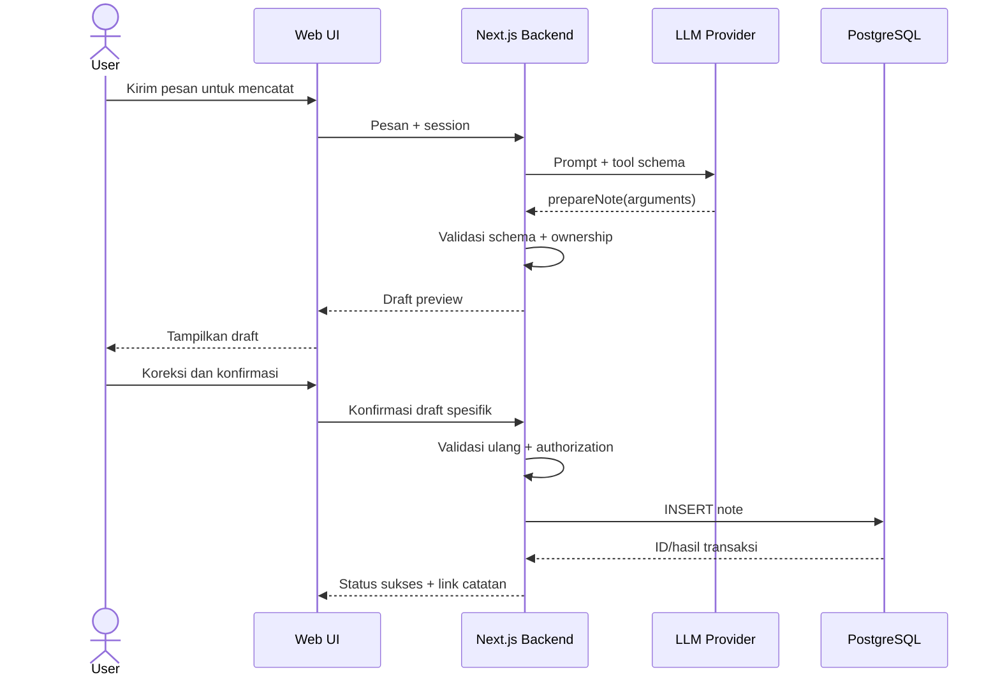
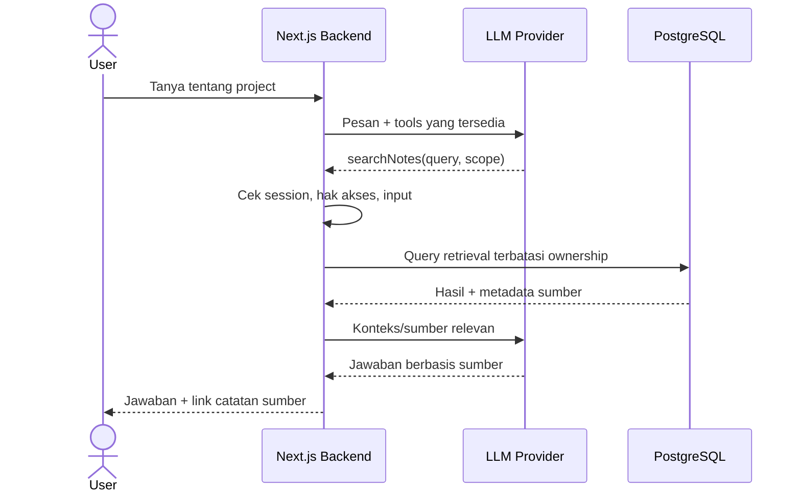

# Product Requirements Document (PRD)

## Personal AI Project Assistant

| Atribut               | Keterangan                                                                                 |
| --------------------- | ------------------------------------------------------------------------------------------ |
| Nama produk           | solyn                                                                                      |
| Versi dokumen         | 0.1 — Draft baseline                                                                       |
| Tanggal               | 13 November 2026                                                                           |
| Status                | Draf disetujui PM                                                                          |
| Sasaran rilis pertama | Fase A — Project Knowledge Assistant (MVP)                                                 |
| Visi jangka panjang   | Fase B — Project Management Assistant; Fase C — Proactive Personal Assistant; potensi SaaS |

> **Status keputusan:** Dokumen ini membedakan keputusan konsep yang telah disepakati, rekomendasi implementasi yang masih dapat berubah, dan fitur roadmap. PRD ini **bukan persetujuan otomatis** untuk migrasi database, perubahan permission, deployment production, atau penambahan layanan berbayar.

---

## 1. Ringkasan produk

Personal AI Project Assistant adalah aplikasi web pribadi untuk menyimpan dan menelusuri pengetahuan berbagai project, khususnya notulen, keputusan, diskusi, dan perkembangan pekerjaan. Pengguna dapat mengelola catatan melalui antarmuka biasa maupun percakapan dengan LLM (_hybrid interface_).

Pada MVP, AI membantu pengguna menyiapkan catatan dari percakapan, mencari informasi historis, menjawab pertanyaan berbasis sumber yang tersimpan, serta menunjukkan asal jawaban. Catatan yang belum dikonfirmasi tidak otomatis menjadi pengetahuan project.

Produk dirancang untuk satu pengguna pada peluncuran awal, tetapi menggunakan model kepemilikan data per akun agar dapat berkembang menjadi aplikasi multi-user dan berpotensi SaaS. **Tidak ada kebutuhan untuk memakai Express hanya karena aplikasi nantinya multi-user/SaaS.**

## 2. Latar belakang dan masalah

Pengguna mengerjakan beberapa project secara paralel. Informasi penting tersebar dalam catatan dan percakapan, sehingga sulit untuk:

1. Mengingat keputusan dan alasan historisnya.
2. Mengetahui pembahasan terakhir dalam satu project.
3. Menemukan catatan tertentu tanpa mengingat tanggal atau judulnya.
4. Menghubungkan pertanyaan natural dengan informasi yang pernah disimpan.
5. Pada fase berikutnya, mengidentifikasi pekerjaan pending dan menentukan prioritas lintas project.

## 3. Tujuan dan keberhasilan

### 3.1 Tujuan MVP (Fase A)

- Pengguna dapat membuat project dan menyimpan notulen/catatan secara manual.
- Pengguna dapat menyampaikan catatan melalui chat; AI membantu menyusun draft untuk ditinjau sebelum disimpan.
- Pengguna dapat menanyakan informasi yang sudah tersimpan dan memperoleh jawaban dengan referensi ke sumber.
- Pengguna tetap dapat membaca, mencari, mengedit, dan mengelola catatan melalui UI tanpa AI.
- Data antar-akun terisolasi sejak awal, walaupun MVP awal hanya memiliki satu akun aktif.

### 3.2 Indikator penerimaan produk

- Semua alur prioritas (membuat project, mencatat manual, mencatat via AI, mencari, bertanya, membuka sumber) dapat diselesaikan end-to-end.
- Setiap jawaban yang mengklaim fakta dari knowledge memiliki referensi sumber yang dapat dibuka.
- Ketika sumber tidak memadai, AI menyatakan ketidakpastian alih-alih mengarang jawaban.
- Penyimpanan knowledge via AI tidak terjadi tanpa konfirmasi pengguna.
- Pengguna A tidak dapat mengakses project, catatan, maupun hasil retrieval milik pengguna B.

> Target kuantitatif untuk akurasi retrieval, latensi, dan biaya per penggunaan ditetapkan setelah baseline pengujian pertama tersedia; jangan mengarang angka target tanpa pengukuran.

## 4. Target pengguna dan batasan awal

**Pengguna awal:** satu pemilik aplikasi yang menangani banyak project pribadi/akademik/pekerjaan.

**Pengguna potensial:** individu lain yang memakai akun terpisah; belum ada kebutuhan workspace bersama, kolaborasi tim, atau organisasi.

**Bahasa interaksi:** Bahasa Indonesia natural, dengan kemungkinan istilah teknis Inggris.

**Input knowledge MVP:** teks yang diketik di editor atau disampaikan lewat chat. Tidak ada upload berkas pada MVP.

## 5. Prinsip produk

1. **Hybrid interface:** chat adalah lapisan interaksi AI; dashboard/editor tetap tersedia sebagai jalur langsung.
2. **Original notes are the source of truth:** penyimpanan catatan asli dan metadata terpisah dari output interpretasi AI.
3. **AI proposes, backend enforces:** LLM menyusun intent/parameter, sedangkan server memvalidasi, mengotorisasi, dan menjalankan operasi data.
4. **Explicit confirmation for writes:** draft AI harus dapat diperiksa/dikoreksi sebelum disimpan sebagai knowledge.
5. **Traceability:** jawaban faktual perlu mengacu pada catatan sumber; status _belum ditemukan_ adalah hasil yang valid.
6. **Single-user launch, multi-user foundation:** seluruh akses data dibatasi berdasarkan akun yang terautentikasi.
7. **Build what is needed:** gunakan modul dan infrastruktur minimum, tanpa framework agent, service terpisah, atau integrasi eksternal yang belum terbukti perlu.

## 6. Scope rilis

### 6.1 In scope — MVP Fase A

- Autentikasi untuk akun pemilik dan session management.
- Project workspace: buat, lihat daftar, ubah metadata project.
- Notulen/catatan: buat, baca, edit, lihat daftar dan detail; metadata project dan waktu.
- Chat AI dan histori chat.
- AI-assisted note preparation dari pesan atau konteks percakapan yang relevan.
- Preview, koreksi, konfirmasi, dan penyimpanan catatan dari AI.
- Pencarian catatan dan retrieval berbasis scope project.
- AI question-answering yang berbasis catatan dan menyertakan referensi sumber.
- Pengisolasian kepemilikan project/catatan/chat per akun.
- Keadaan UI yang jelas untuk loading, gagal, hasil kosong, dan ketidaktersediaan LLM.

### 6.2 Out of scope — MVP

- Upload PDF/DOCX/gambar, OCR, serta ingestion dari file.
- Integrasi Google Calendar atau kalender eksternal lain.
- Deadline, action items terstruktur, dependency, dashboard prioritas pekerjaan, reminder, dan automation.
- Agent otonom yang melakukan perubahan tanpa review pengguna.
- Kolaborasi project bersama, role tim, organisasi, dan permission sharing.
- Registrasi publik, subscription, pembayaran, kuota paket, dan billing SaaS.
- Mobile native app.
- Microservices, Express terpisah, message broker, dan vector database terpisah.

### 6.3 Roadmap non-komitmen

**Fase B — Project Management Assistant:** action items, deadline, status, dependency, keputusan terstruktur, ekstraksi task dari catatan dengan review pengguna, serta dashboard tugas yang bisa diperbarui dengan bantuan AI.

**Fase C — Proactive Personal Assistant:** rekomendasi prioritas berdasarkan deadline, dependency, dampak, dan status; usulan urutan pengerjaan; deteksi item tertunda; reminder atau pemantauan terjadwal bila dibutuhkan. AI dapat membantu mengelola tetapi perubahan penting harus dikendalikan pengguna.

**Potensi SaaS:** onboarding mandiri, pendaftaran pengguna, isolasi tenant yang diuji, rate limit/kuota, observability, privacy policy, billing, retensi/penghapusan data, dan pengamanan abuse. Bentuk tenancy final (akun individual vs organisasi) ditentukan saat kebutuhan SaaS nyata muncul.

## 7. User journeys

### UJ-01 — Menulis catatan lewat UI

1. Pengguna memilih atau membuat project.
2. Membuka editor, mengisi isi catatan dan metadata minimum.
3. Menyimpan catatan.
4. Catatan muncul di daftar dan dapat dibuka kembali.
5. Catatan tersedia untuk pencarian; jika indeks belum siap, sistem tetap menyimpan catatan asli dan menunjukkan status yang sesuai.

### UJ-02 — Menyimpan catatan lewat chat

1. Pengguna menulis, misalnya: “Catet buat RESORA, absensi QR diprioritaskan dan permission masih perlu diskusi.”
2. AI mengidentifikasi intent penyimpanan dan menyiapkan draft terstruktur.
3. Backend memvalidasi schema dan scope. Pada project chat, target tetap project asal yang dimiliki pengguna; pada general chat, pengguna memilih project miliknya secara eksplisit di preview sebelum konfirmasi. Hint nama dari AI tidak otomatis memilih project.
4. Bila informasi esensial ambigu, AI meminta klarifikasi melalui chat; bila tidak esensial, sistem menggunakan nilai opsional/default yang aman.
5. UI menampilkan preview draft yang dapat dikoreksi.
6. Pengguna mengonfirmasi melalui aksi yang eksplisit.
7. Backend menyimpan dan mengembalikan identifier catatan; UI/AI menampilkan hasil yang benar-benar terverifikasi.

### UJ-03 — Bertanya tentang histori project

1. Pengguna menanyakan, misalnya: “Kenapa fitur X di RESORA ditunda?”
2. AI memilih tool pencarian catatan dengan scope project relevan.
3. Backend mengecek akses, menjalankan retrieval, lalu mengembalikan potongan/hasil dan metadata sumber.
4. AI menyusun jawaban yang didukung bukti.
5. Pengguna dapat membuka sumber asli dari jawaban.
6. Jika bukti tidak cukup atau saling bertentangan, AI menyatakan keterbatasan dan memperlihatkan informasi yang ditemukan.

### UJ-04 — Menggunakan aplikasi tanpa LLM

Pengguna tetap dapat membaca project, melihat daftar/detail catatan, mengedit, dan mencari berdasarkan UI meskipun layanan AI tidak tersedia.

## 8. Functional requirements (MVP)

| ID    | Requirement                                                            | Prioritas | Acceptance criteria                                                                       |
| ----- | ---------------------------------------------------------------------- | --------- | ----------------------------------------------------------------------------------------- |
| FR-01 | Pengguna dapat login/logout secara aman                                | Must      | Endpoint/data terlindungi dari pengguna tanpa session valid                               |
| FR-02 | Pengguna dapat membuat dan mengelola project miliknya                  | Must      | Project tampil di daftar pemilik; pengguna lain tidak dapat mengakses                     |
| FR-03 | Pengguna dapat membuat, membaca, dan mengedit catatan melalui UI       | Must      | Isi dan metadata tersimpan dan dapat dibaca ulang                                         |
| FR-04 | Catatan terkait ke tepat satu project pemilik                          | Must      | Backend menolak hubungan project yang tidak dimiliki pengguna                             |
| FR-05 | Pengguna dapat memulai/melanjutkan chat dan melihat histori            | Must      | Histori percakapan dipersistenkan sesuai akun                                             |
| FR-06 | AI dapat menyusun draft catatan melalui schema/tool terstruktur        | Must      | Draft valid atau meminta klarifikasi; tidak melakukan write langsung                      |
| FR-07 | Pengguna dapat meninjau, memperbaiki, lalu mengonfirmasi draft         | Must      | Tanpa konfirmasi, tidak ada penyimpanan knowledge dari AI                                 |
| FR-08 | Backend menyimpan catatan terkonfirmasi dengan validasi dan otorisasi  | Must      | Hasil sukses hanya muncul setelah database mengonfirmasi penyimpanan                      |
| FR-09 | Pengguna dapat mencari catatan dalam satu project                      | Must      | Hasil selalu dibatasi ke project yang dapat diakses                                       |
| FR-10 | AI dapat menjawab berdasarkan hasil retrieval dan menyebutkan sumber   | Must      | Jawaban menyertakan rujukan ke catatan yang benar-benar ditemukan                         |
| FR-11 | Pengguna dapat membuka catatan sumber dari hasil jawaban               | Must      | Link sumber membuka catatan yang sesuai dan telah diotorisasi                             |
| FR-12 | Sistem menangani hasil kosong, sumber ambigu, dan kegagalan provider   | Must      | Tidak mengarang fakta atau mengklaim write berhasil saat gagal                            |
| FR-13 | Pencarian lintas project pribadi tersedia melalui scope eksplisit      | Should    | Hanya data milik user yang digunakan; scope dapat dipahami pengguna                       |
| FR-14 | Sistem dapat membedakan tanggal catatan dan waktu penyimpanan          | Should    | Tanggal historis yang tidak diketahui tidak otomatis diklaim sebagai tanggal meeting      |
| FR-15 | Riwayat revisi catatan yang memadai untuk menelusuri perubahan penting | Should    | Mekanisme minimal diputuskan saat desain rinci, sebelum edit historis berisiko diterapkan |

**Catatan:** _Must_ = diperlukan untuk penerimaan MVP; _Should_ = dianjurkan dalam MVP bila biaya dan kompleksitasnya proporsional. Penghapusan data, perilaku edit versioned, dan kebijakan retensi memerlukan keputusan desain lanjutan.

## 9. UX / antarmuka

### 9.1 Struktur halaman konseptual

- **Dashboard:** daftar project dan akses ke chat; belum ada widget deadline/task otomatis dalam MVP.
- **Project detail:** metadata, daftar catatan, pencarian, dan akses chat dengan scope project.
- **Note editor/detail:** konten asli, tanggal terkait, metadata sumber, dan edit.
- **Chat:** input natural, histori percakapan, respons dengan sumber, serta preview/konfirmasi draft.
- **Settings/account:** profil dasar, logout, dan konfigurasi provider yang aman bila dibutuhkan.

### 9.2 Aturan pengalaman chat

- Pertanyaan dan perintah write dibedakan berdasarkan intent.
- AI hanya bertanya ulang bila data yang esensial kurang atau ambigu.
- Draft adalah usulan, bukan fakta yang telah tersimpan.
- Konfirmasi harus merujuk ke draft yang spesifik, bukan sekadar pesan samar.
- Kesalahan pemanggilan tools ditampilkan sebagai kegagalan, bukan disembunyikan sebagai keberhasilan.
- Hasil pencarian/jawaban harus memiliki navigasi balik ke sumber.

## 10. Arsitektur teknis usulan

### 10.1 Stack

| Layer              | Rekomendasi                                       | Status                                             |
| ------------------ | ------------------------------------------------- | -------------------------------------------------- |
| Aplikasi FE + BE   | Next.js Fullstack + TypeScript                    | Diimplementasikan dalam Bun workspace             |
| Styling/komponen   | Tailwind CSS + shared shadcn-style/Base UI        | Diimplementasikan; arah visual di `DESIGN.md`       |
| Auth               | Better Auth                                       | Diimplementasikan; registrasi publik dinonaktifkan |
| ORM                | Drizzle ORM                                       | Diimplementasikan                                  |
| Database utama     | Supabase PostgreSQL                               | Diimplementasikan                                  |
| LLM                | Groq — `openai/gpt-oss-120b`                       | Dipakai oleh chat dan persiapan draft              |
| Integrasi LLM      | Vercel AI SDK + adapter Groq                       | Diimplementasikan                                  |
| Retrieval awal     | PostgreSQL full-text/keyword + filter project     | Rekomendasi MVP                                    |
| Semantic retrieval | Embeddings + pgvector                             | Tambahan bertahap bila diperlukan                  |
| Deployment         | Docker + VPS                                      | Opsi familiar; belum diputuskan untuk aplikasi ini |

**Struktur deployment:** satu aplikasi Next.js (UI dan server-side API), satu database PostgreSQL, dan panggilan server-side ke provider LLM. Modul AI orchestration, tool registry, retrieval, dan database access adalah pemisahan tanggung jawab dalam aplikasi, **bukan microservices**.

### 10.2 Batas tanggung jawab

- **Frontend:** menangkap intent user dan menampilkan chat, draft, sumber, dan state operasi.
- **AI orchestrator (server):** menyediakan konteks, daftar tools, dan batasan instruksi ke model.
- **LLM:** memilih tool dan mengusulkan argumen berdasarkan teks user; tidak memiliki kredensial database.
- **Tool handlers (server):** memvalidasi input terstruktur dan memanggil application services.
- **Application/data services:** menerapkan aturan kepemilikan, validasi bisnis, transaksi, dan persistensi via ORM.
- **Retrieval:** menggunakan query yang dikendalikan server, bukan SQL bebas hasil generasi model.

### 10.3 Tool kontrak konseptual

**Status implementasi Phase 4:** model menerima `prepareNote` berbasis schema tanpa `execute` dan tool read-only `searchNotes`. Main Chat mencari lintas project milik akun dari session server; Project Chat tetap pada satu project terotorisasi. Referensi Retrieved notes dipersistenkan dan metadata diotorisasi ulang saat dibaca; ini bukan verifikasi setiap klaim atau inline citations dari model. Backend memvalidasi dan mempersistenkan proposal; konfirmasi note dilakukan melalui authenticated Server Action `confirmNoteProposal`, bukan tool `saveNote` milik model. `listProjects`/`getNote` tersedia untuk UI melalui backend, tetapi tidak diberikan ke model. Tabel berikut mempertahankan kontrak konseptual MVP, bukan daftar tools yang saat ini tersedia untuk LLM.

| Tool           | Hak      | Keterangan                                                                          |
| -------------- | -------- | ----------------------------------------------------------------------------------- |
| `listProjects` | Read     | Daftar project milik user dari session server                                       |
| `searchNotes`  | Read     | Cari catatan sesuai query, scope, dan batas hasil                                   |
| `getNote`      | Read     | Ambil catatan tertentu setelah cek kepemilikan                                      |
| `prepareNote`  | No write | Siapkan draft terstruktur dari pesan/konteks chat                                   |
| `saveNote`     | Write    | Simpan hanya draft yang sudah dikonfirmasi; tidak menerima otorisasi dari klaim LLM |

Contoh draft yang diproduksi AI (ilustrasi, bukan API final):

```json
{
	"project": "RESORA",
	"title": "Diskusi Absensi dan Permission",
	"content": "Fitur absensi QR diprioritaskan. Permission masih memerlukan diskusi lanjutan.",
	"noteDate": null
}
```

Pada implementasi saat ini, AI memberi `projectHint` nullable, bukan project identifier; pengguna memilih target general chat secara eksplisit, sedangkan project chat mempertahankan scope asal. Backend memeriksa kepemilikan, mengambil user identifier dari session, dan menghasilkan identifier catatan di server. LLM **tidak** menerima operasi seperti `executeSQL`.

### 10.4 Alur write



**Pengamanan draft:** gunakan draft identifier dan status yang dikendalikan server (atau mekanisme ekuivalen yang aman); jangan menerima `confirmed: true` yang hanya diusulkan oleh model sebagai bukti persetujuan pengguna. Phase 3 menggunakan proposal ID sebagai identitas operasi dan receipt immutable untuk replay idempotent; kontrak teknis ada di `NOTE_PROPOSALS.md`.

### 10.5 Alur read



### 10.6 Strategi retrieval

MVP dimulai dari pencarian teks dan metadata (project, judul, konten, tanggal) dengan query PostgreSQL yang terbatas menurut user/project. Jika hasil evaluasi menunjukkan kebutuhan pencarian semantik, tambahkan chunking, embedding, pgvector, dan bila perlu hybrid retrieval. Untuk pertanyaan seperti “keputusan terakhir”, pencarian harus mempertimbangkan kronologi dan kemungkinan keputusan yang telah direvisi, tidak mengandalkan similarity saja.

## 11. Model data konseptual

| Entitas                      | Fungsi minimum                                                                      |
| ---------------------------- | ----------------------------------------------------------------------------------- |
| `users` / tabel auth terkait | Akun pengguna, dikelola sesuai kebutuhan auth library                               |
| `projects`                   | Nama/metadata project, `ownerId`, timestamps                                        |
| `notes`                      | Project, judul, konten asli, tanggal terkait (opsional), timestamps                 |
| `chat_sessions`              | Pemilik, konteks project opsional, metadata sesi                                    |
| `chat_messages`              | Sesi, role, konten, waktu, informasi referensi/tool bila diperlukan                 |
| `note_chunks`                | **Opsional/later:** bagian teks, referensi note, embedding untuk semantic retrieval |

**Aturan isolasi:** seluruh akses notes diturunkan dari kepemilikan project atau mekanisme otorisasi setara, dan seluruh chat dari user pemilik. Jangan mempercayai `userId` yang dikirim LLM/client. Validasi kepemilikan tetap harus dilakukan pada akses langsung maupun tool AI.

**Status implementasi:** skema fisik dan index minimum sudah tersedia di `packages/db/src/schema`. Entitas chat fisik adalah `chat_conversations` dan `chat_messages` (bukan tabel `chat_sessions`). `note_revisions` menyimpan snapshot versi keluar pada edit bermakna secara atomik; `note_proposals` menyimpan draft asli dan receipt konfirmasi terpisah. Fragmen tool mentah tidak menjadi knowledge atau log tool umum. `note_chunks`/embeddings belum dibuat.

**Retensi saat ini:** pemilik dapat menghapus permanen thread Main Chat beserta messages dan proposals/receipts melalui aksi terautentikasi P4.6F. Notes terkonfirmasi dan riwayat revisinya tetap disimpan; pending generation memblokir penghapusan hingga recovery yang ada menyelesaikannya. Tidak ada expiry otomatis atau penghapusan akun/project/notes. Kebijakan retensi lebih lanjut dan penyimpanan tool tambahan tetap memerlukan review terpisah.

## 12. Non-functional requirements

| Area            | Kebutuhan                                                                                                                |
| --------------- | ------------------------------------------------------------------------------------------------------------------------ |
| Security        | API key LLM dan kredensial database hanya di server; seluruh endpoint dan tool memverifikasi session serta ownership     |
| Privacy         | Minimalkan konten yang dikirim ke LLM; transparansi bahwa catatan yang diperlukan dapat dikirim ke provider eksternal    |
| Data integrity  | Save harus atomik pada operasi yang relevan; gagal menyimpan tidak boleh ditampilkan sebagai sukses                      |
| Availability    | Notes CRUD dan pencarian non-AI tetap berfungsi ketika provider LLM down                                                 |
| Reliability     | Tangani timeout, rate limit, respons tool invalid, retry aman, dan pencegahan duplicate save                             |
| Traceability    | Simpan hubungan jawaban ke sumber (dan, bila perlu, versi sumber) agar dapat diperiksa                                   |
| Performance     | Pantau latensi chat, waktu retrieval, dan beban database; tetapkan SLA/SLO setelah pengukuran                            |
| Cost control    | Batas jumlah konteks dan tool calls; pengukuran token/biaya; pembatasan penggunaan per akun jika berkembang menjadi SaaS |
| Maintainability | Satu codebase; typed schemas; unit/integration tests untuk tool dan authorization                                        |
| Backup/recovery | Tetapkan kebijakan backup dan uji restore sebelum data penting dipercayakan untuk penggunaan rutin                       |

## 13. Risiko dan mitigasi

| Risiko                                          | Dampak                             | Mitigasi awal                                                                          |
| ----------------------------------------------- | ---------------------------------- | -------------------------------------------------------------------------------------- |
| AI mengarang atau mencampur keputusan lama/baru | Jawaban salah                      | Source citation, batas retrieval, tanggal, jawaban “tidak ditemukan”                   |
| AI mengekstrak catatan secara keliru            | Knowledge salah                    | Preview dan konfirmasi sebelum write                                                   |
| Prompt injection di isi note                    | Operasi tak sah/manipulasi jawaban | Perlakukan teks retrieval sebagai data tak tepercaya; allowlist tools; validasi server |
| Kebocoran lintas user                           | Kebocoran data sensitif            | Query scoped ke user, pengujian negative authorization                                 |
| API key terekspos                               | Penyalahgunaan layanan             | Server-side secrets only                                                               |
| Perubahan notes menghapus jejak historis        | Hilangnya alasan keputusan         | Tentukan audit/revision minimal sebelum fitur edit digunakan intensif                  |
| Penggunaan LLM mahal/berulang                   | Biaya meningkat                    | Token/tool limits, logs biaya, rate limiting                                           |
| Kegagalan indexing                              | Note tak bisa ditemukan            | Status indeks, retry yang terkontrol, fallback ke pencarian teks                       |

## 14. Skenario pengujian penerimaan

1. Buat project, buat note manual, refresh, dan pastikan note tetap ada.
2. Minta AI menyiapkan note; sebelum konfirmasi, pastikan tidak ada knowledge baru di database.
3. Koreksi draft lalu konfirmasi; pastikan yang tersimpan adalah versi terakhir yang dikonfirmasi.
4. Jalankan konfirmasi dua kali; sistem tidak menghasilkan duplicate note tanpa disengaja.
5. Tanya fakta yang ada dalam note; jawaban dapat ditelusuri ke sumber yang benar.
6. Tanya fakta yang tidak ada; sistem tidak membuat sumber palsu.
7. Buat dua user uji; akses langsung dan AI retrieval dari user B terhadap data user A harus ditolak.
8. Simulasikan kegagalan provider LLM; UI notes dan data utama tetap dapat digunakan.
9. Uji query lintas project; hasil tidak keluar dari scope user terautentikasi.
10. Uji prompt injection dalam konten notes; retrieval tidak dapat mengubah instruksi tool atau melewati konfirmasi write.

## 15. Tahap implementasi

| Tahap                | Fokus                                                         | Exit criteria                                                  |
| -------------------- | ------------------------------------------------------------- | -------------------------------------------------------------- |
| 1. Foundation        | Auth, project CRUD, notes CRUD, desain ownership              | Penyimpanan manual dan akses lintas-user tervalidasi           |
| 2. Chat              | Chat UI, sesi, histori, provider API                          | Percakapan tersimpan dan error handling bekerja                |
| 3. AI-assisted write | Tool schema, draft preview, konfirmasi, save                  | Pengguna bisa menyimpan catatan dari chat secara aman          |
| 4. Knowledge Q&A     | Read tools, retrieval, citations                              | AI menjawab berdasarkan sumber dan dapat menyatakan tidak tahu |
| 5. Hardening MVP     | Evaluasi jawaban, tes keamanan, backup, observability minimum | Kriteria penerimaan dan tes kritis lulus                       |
| Future B             | Task/deadline/dashboard + AI-assisted management              | Scope dan desain disetujui secara terpisah                     |
| Future C             | Prioritization + proactive actions                            | Trigger, batas otonomi, dan approval flow disetujui            |
| Future SaaS          | Onboarding publik, kuota/billing, legal/ops                   | Business model dan tenancy diputuskan                          |

## 16. Keputusan yang sudah disepakati vs terbuka

### 16.1 Disepakati secara konsep

- Mulai dari **Fase A**, dengan kemungkinan ekspansi ke B dan C.
- Gunakan **Next.js Fullstack** sebagai arah arsitektur, bukan Next.js + Express.
- Interface **hybrid**: chat dan UI tradisional.
- Knowledge awal dari **teks manual dan chat**, bukan file upload.
- Chat memakai **tool/function calling** dengan parameter terstruktur; backend melakukan query/write.
- **Konfirmasi pengguna** sebelum AI memasukkan catatan ke knowledge.
- MVP dipakai satu orang, tetapi **fondasi akun multi-user** disiapkan.
- Integrasi Google Calendar tidak wajib.

### 16.2 Keputusan implementasi terselesaikan dan yang masih terbuka

**Sudah terselesaikan oleh implementasi Phase 1–3:**

- Nama Solyn dan baseline visual v2.0 tersedia di `DESIGN.md`; penerimaan visual tetap milik PM.
- Chat memakai Groq, `openai/gpt-oss-120b` dan Vercel AI SDK dengan API key server-side serta batas konteks/output/timeout.
- Better Auth, provisioning owner terkendali dan penolakan registrasi publik sudah tersedia.
- General chat tidak memerlukan project aktif; target note dipilih eksplisit sebelum konfirmasi. Project chat mempertahankan scope asal.
- Edit note bermakna mengarsipkan versi keluar secara atomik; konfirmasi proposal memakai receipt idempotent.

**Masih terbuka sebelum implementasi/operasi yang relevan:**

1. Evaluasi biaya/harga provider, kebijakan pemrosesan data dan kontrol biaya operasional jangka panjang.
2. Kebijakan penghapusan dan retensi final catatan/chat/proposal.
3. Apakah semantic search diperlukan berdasarkan evaluasi lanjutan; retrieval saat ini memakai pencarian substring literal PostgreSQL yang dibatasi ownership/project. Embeddings bukan persyaratan otomatis.
4. Tempat deployment dan kebijakan backup/restore.
5. Definisi tenant serta collaborative sharing **hanya jika** fase SaaS benar-benar disetujui.

## 17. Kriteria selesai Fase A

MVP dapat dianggap selesai setelah seluruh requirement _Must_ terpenuhi, skenario penerimaan kritis lulus dengan bukti, dan review keamanan akses data, validasi tool, serta kegagalan layanan dilakukan. Fitur roadmap B/C/SaaS **tidak** menjadi blocker untuk menerima fase A.

---

**Catatan pengelolaan scope:** Setiap tambahan fitur, perubahan arsitektur besar, migrasi skema, permission baru, dan perubahan deployment harus melalui analisis dampak serta persetujuan PM sebelum diimplementasikan.
