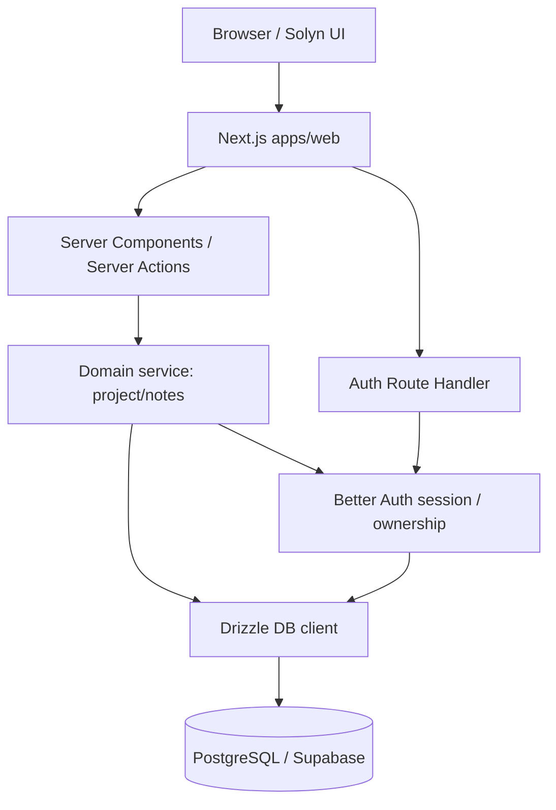

# Solyn — Technical Design: Phase 1 (Foundation & Core Workspace)

**Status:** Draft untuk review PM; belum menjadi persetujuan perubahan auth atau migrasi database  
**Tanggal:** 17 November 2026
**Repository:** https://github.com/solc1us/solyn  
**Basis audit:** branch `main`, commit `a3e8790b436a5c381e5c629afc4399364ddc5a46`  
**Produk acuan:** [`docs/PRD.md`](https://github.com/solc1us/solyn/blob/main/docs/PRD.md) — MVP fase A

## 1. Ringkasan keputusan desain

Solyn dipertahankan sebagai **Next.js fullstack dalam Bun workspace monorepo**, sesuai scaffold Better-T-Stack. Fase 1 membangun pengalaman **project + manual notes** yang berfungsi tanpa LLM. Multi-user _data ownership_ dirancang sejak awal, tetapi onboarding publik/SaaS bukan scope MVP. Backend berada dalam Next.js; tidak ditambah Express, tRPC, agent framework, atau vector database.

**Batas pekerjaan:** dokumen ini adalah desain dan rencana; belum ada perubahan repository, database, atau deployment. Seluruh perubahan schema, behavior auth/permission, dan migrasi harus disetujui PM sebelum dieksekusi.

## 2. Audit aktual repository

| Area             | Bukti di `main`                                                                                                      | Konsekuensi                                                                  |
| ---------------- | -------------------------------------------------------------------------------------------------------------------- | ---------------------------------------------------------------------------- |
| Generator        | `bts.jsonc`: Better-T-Stack v3.49.0, `frontend=next`, `backend=self`, `api=none`, `auth=better-auth`                 | Pertahankan scaffold                                                         |
| Workspace        | Root `package.json` memakai Bun workspaces `apps/*` dan `packages/*`                                                 | Tidak perlu konversi menjadi single-package                                  |
| Web              | `apps/web`, Next.js 16.3.4, React 19, route handlers                                                                 | App/server tetap satu deployment aplikasi                                    |
| Auth             | `packages/auth/src/index.ts`: Better Auth 1.7.12, Drizzle adapter, email/password enabled                            | Implementasi auth ada; keamanan registrasi harus ditentukan                  |
| Existing auth UX | `apps/web/src/app/login/page.tsx` menampilkan sign-up sebagai default; endpoint `app/api/auth/[...all]/route.ts` ada | Registrasi publik belum dibatasi menurut kode yang diaudit                   |
| Protected page   | `apps/web/src/app/dashboard/page.tsx` memanggil `auth.api.getSession` dan redirect ke `/login`                       | Pola server-side session check tersedia untuk dipakai ulang                  |
| DB               | `packages/db`: driver `pg`, Drizzle ORM 1.0.0-rc.5, `createDb`, auth schema                                          | Tambah domain schema tanpa mengganti DB package                              |
| Schema           | `packages/db/src/schema/auth.ts` memuat `user`, `session`, `account`, `verification`                                 | `projects` dan `notes` belum ada                                             |
| Migrations       | `packages/db/src/migrations/` berisi `.gitkeep`                                                                      | Tidak terlihat migrasi committed; kondisi database remote belum diverifikasi |
| UI               | `packages/ui` berisi shadcn-style primitives dan Tailwind; layout global & header scaffold                           | Reuse component/tokens existing                                              |
| Validation       | Root scripts `check-types`, `build`, `check` (oxlint + **oxfmt --write**)                                            | `check` bersifat memodifikasi file; jangan dianggap read-only                |
| Env              | `apps/web/.env.schema`: `BETTER_AUTH_URL`, `BETTER_AUTH_SECRET`, `DATABASE_URL`; Varlock digunakan                   | Validasi konfigurasi tanpa mencatat/menampilkan secrets                      |
| Branch           | Branch remote yang terlihat hanya `main`                                                                             | Gunakan branch fitur per unit; workflow `dev` belum ada                      |

**Batas verifikasi:** audit dilakukan melalui isi repository di GitHub, bukan dengan menjalankan aplikasi. Tidak dapat disimpulkan bahwa koneksi Supabase, database auth, login end-to-end, lint, typecheck, atau build sudah lulus.

Rujukan utama: [root package.json](https://github.com/solc1us/solyn/blob/main/package.json), [auth config](https://github.com/solc1us/solyn/blob/main/packages/auth/src/index.ts), [auth schema](https://github.com/solc1us/solyn/blob/main/packages/db/src/schema/auth.ts), [database](https://github.com/solc1us/solyn/tree/main/packages/db), [login UI](https://github.com/solc1us/solyn/blob/main/apps/web/src/app/login/page.tsx), [PRD](https://github.com/solc1us/solyn/blob/main/docs/PRD.md).

## 3. Scope fase 1

**Masuk scope:**

1. Verifikasi konfigurasi lingkungan _development_, autentikasi/session, dan akses login/logout.
2. Pembatasan registrasi untuk peluncuran pribadi dengan satu akun awal, tanpa menutup jalan multi-user di masa depan.
3. Skema domain `projects` dan `notes`, relasi serta index minimal.
4. Project listing, create, detail, dan edit metadata.
5. Note listing, create, detail, dan edit dengan metadata tanggal terpisah dari waktu pencatatan.
6. Authenticated workspace UI dan state loading/empty/error.
7. Tes ownership, validasi, dan jalur tanpa session.

**Di luar scope:** AI chat, tool calling, embeddings/RAG, upload file, task/deadline, Google Calendar, sharing, role organisasi, pembayaran, public registration, delete permanen, auto-archiving, deployment production.

## 4. Target arsitektur

**Package boundaries:**

- `apps/web`: route/page/layout, UI state, server actions/handlers, domain application services, server-side authorization.
- `packages/auth`: Better Auth configuration; hindari perubahan di luar kebutuhan onboarding yang disetujui.
- `packages/db`: schema, relations, migration, database client; tidak perlu generic repository abstraction.
- `packages/ui`: existing primitives dan global design tokens; komponen spesifik Solyn sebaiknya tetap di web jika tidak digunakan lintas aplikasi.

**Write path:** Client form → Server Action (sesuai konvensi Next.js yang ditemukan saat implementasi) → session/owner validation → Zod validation → Drizzle statement → refresh/revalidation UI. **Read path:** Server Component → session → scoped query → render. Endpoint HTTP tambahan hanya dibuat jika ada konsumen yang membutuhkannya. Pada fase AI, tool calls memanggil application services yang sama, bukan SQL langsung dari LLM.

**Security boundary:** `userId` berasal hanya dari server session; semua pembacaan dan mutasi `project` memeriksa `ownerId`; notes diakses dengan pemeriksaan kepemilikan project induk dalam query, bukan sekadar cek route atau menyembunyikan UI. Untuk ID valid tapi tidak dimiliki user, tampilkan not found yang tidak membocorkan eksistensi record.

## 5. Data model yang diusulkan (belum dimigrasikan)

### 5.1 Existing auth (tidak dimodifikasi tanpa kebutuhan)

`user`, `session`, `account`, `verification` sesuai `packages/db/src/schema/auth.ts` saat ini. `user.id` bertipe `text`; PK ini menjadi FK kepemilikan project.

### 5.2 `projects` — baru

| Kolom         | Rancangan                      | Aturan                                           |
| ------------- | ------------------------------ | ------------------------------------------------ |
| `id`          | UUID, server/DB-generated, PK  | Opaque identifier                                |
| `owner_id`    | text, FK → `user.id`, not null | Wajib diambil dari session                       |
| `name`        | text, not null                 | Trim; batas panjang ditentukan saat implementasi |
| `description` | text, nullable                 | Metadata opsional                                |
| `created_at`  | `timestamptz`, not null        | Server-generated                                 |
| `updated_at`  | `timestamptz`, not null        | Diperbarui ketika metadata berubah               |

Index: `(owner_id, updated_at)` untuk daftar project berdasarkan pemilik. Tidak perlu unique name, category, slug, color, owner sharing, status, atau soft-delete di fase 1.

### 5.3 `notes` — baru

| Kolom        | Rancangan                          | Aturan                                                            |
| ------------ | ---------------------------------- | ----------------------------------------------------------------- |
| `id`         | UUID, PK                           | Opaque identifier                                                 |
| `project_id` | UUID, FK → `projects.id`, not null | Setiap note tepat satu project                                    |
| `title`      | text, not null                     | Validasi nonblank                                                 |
| `content`    | text, not null                     | Konten asli, bukan ringkasan AI                                   |
| `note_date`  | date, nullable                     | Tanggal peristiwa; **tidak** diasumsikan sama dengan `created_at` |
| `created_at` | `timestamptz`, not null            | Waktu disimpan                                                    |
| `updated_at` | `timestamptz`, not null            | Waktu edit terakhir                                               |

Index: `(project_id, updated_at)`. `owner_id` tidak digandakan di notes; kepemilikan diwarisi melalui project dan dibuktikan di server query. Validasi tanggal terpisah dari timezone database. Tidak perlu embeddings, chunking, task rows, tags, atau JSON blobs di fase 1.

### 5.4 Kebijakan revisi dan penghapusan — keputusan terbuka

PRD memberi **FR-15 / Should** untuk audit revisi. Karena Solyn akan menjawab pertanyaan historis, risiko overwrite konten pada edit perlu diperhatikan.

**Usulan:** ketika edit konten tersedia, simpan snapshot versi sebelum edit secara atomik ke tabel kecil `note_revisions` (`note_id`, `version`, snapshot `title/content/note_date`, `created_at`) dan perbarui note utama pada transaksi yang sama. UI timeline versi lengkap boleh ditunda. Alternatif paling minimal adalah belum mengaktifkan edit konten sampai mekanisme revisi disepakati. **Tidak menyarankan overwrite diam-diam** jika kehilangan histori menjadi risiko yang tidak dapat diterima.

Tidak membuat delete operation pada fase 1. Penghapusan akun/project dan perilaku FK harus diputuskan secara eksplisit sebelum endpoint destruktif diperkenalkan.

## 6. Authentication & onboarding

**Kondisi saat audit:** `emailAndPassword: { enabled: true }` pada Better Auth, tersedia sign-up form, dan tidak terlihat penolakan sign-up publik di server. `dashboard/page.tsx` memeriksa session, tetapi proteksi terhadap semua domain data belum ada karena domain route belum diimplementasikan.

**Desain yang diusulkan:**

- Hanya satu akun owner aktif saat peluncuran pribadi; schema tetap mendukung akun lain.
- Login/logout berbasis mekanisme Better Auth existing.
- Pembuatan akun awal melalui **bootstrap terkendali** (misalnya provisioning manual di environment dev yang dipercaya), kemudian registrasi baru diblokir **di server** dan pilihan sign-up disembunyikan di UI. Jangan hanya menyembunyikan tombol.
- Metode bootstrap final harus disesuaikan dengan API Better Auth versi repository; jangan membuat bypass auth, seed password plaintext, atau script sementara di production tanpa review.
- Validasi session juga wajib pada server actions, domain services, dan bila ada API routes; redirect dashboard saja bukan authorization.
- Tidak perlu menambahkan teams, organizations, roles, invitations umum, atau admin panel.

**Approval gate A:** PM harus menyetujui detail bootstrap dan perubahan perilaku sign-up sebelum implementasi auth dimulai.

## 7. UI / navigation design

Halaman minimal yang disarankan (path final dipilih mengikuti existing routing):

- `/login`: sign-in ketika bootstrap sudah selesai.
- `/dashboard`: daftar project, create project, empty state.
- `/projects/[projectId]`: detail/edit project, daftar note dan tambah note.
- `/projects/[projectId]/notes/[noteId]`: baca/edit note, metadata tanggal dan updated timestamp.

Layout aplikasi menggunakan header dan providers existing sebagai baseline; pertimbangkan workspace sidebar bila benar-benar diperlukan untuk navigasi. Gunakan shared UI primitives dari `packages/ui`; bentuk komponen fitur di `apps/web`. Tidak membuat halaman chat kosong sebagai dependency fase 1. Sediakan validasi inline, loading/error feedback, mobile responsive minimum, dan akses keyboard dasar.

## 8. Kontrak domain konseptual (bukan REST endpoint wajib)

| Operasi         | Input dari UI                        | Server invariant                             |
| --------------- | ------------------------------------ | -------------------------------------------- |
| `listProjects`  | session                              | Filter `projects.owner_id = session.user.id` |
| `createProject` | name, description?                   | Owner ID dari session; validasi server       |
| `getProject`    | projectId                            | ID + owner harus cocok                       |
| `updateProject` | projectId, allowed fields            | Update hanya milik owner; field allowlist    |
| `listNotes`     | projectId                            | Project wajib dimiliki user                  |
| `createNote`    | projectId, title, content, noteDate? | Validasi project ownership                   |
| `getNote`       | projectId, noteId                    | Query dengan note + project + owner          |
| `updateNote`    | projectId, noteId, fields            | Owner check; jika versioned, write atomik    |

Gunakan Zod yang sudah ada. Batasi ukuran payload untuk mencegah input arbitrer besar. Batasi field update untuk menghindari mass assignment, tidak menerima ownerId/userId dari browser. Tidak ada generic `executeSQL`/dynamic query interface.

## 9. Implementation slices & dependencies

### 1A — Baseline verification (read-only)

- Inspeksi branch, scripts, generated env/schema, konfigurasi dan auth wiring.
- Jalankan pemeriksaan lokal tanpa menjalankan migrasi remote; pastikan `bun run check-types` dan `bun run build` dapat dilakukan pada environment terkonfigurasi; catat blocker.
- **Jangan menjalankan `bun run check` tanpa sadar:** script menjalankan `oxfmt --write`; lakukan di branch kerja atau gunakan perintah lint non-mutating jika ingin audit.

**DoD:** hasil verifikasi scaffold dan kebutuhan environment tercatat, bukan sekadar klaim "build aman".

### 1B — Account onboarding / auth hardening (**setelah approval A**)

- Tetapkan bootstrap dan blokir server-side sign-up non-approved; sesuaikan login UI.
- Test login, logout, unauth redirect, dan penolakan pendaftaran baru.

**DoD:** pengguna terotorisasi dapat mengakses workspace, pengguna anonim/pendaftar lain tidak.

### 1C — Domain schema & migration (**setelah approval B**)

- Tambah schema domain pada package DB, relations sesuai Drizzle v1 existing, migration SQL generated.
- Review SQL hasil generate, foreign key, indexes, timestamps, dan perubahan auth schema (seharusnya tidak berubah jika tidak dibutuhkan).
- Jalankan migration **hanya** pada database development/staging yang sudah dipilih dan disetujui PM; hindari `db:push` ke database remote tanpa review.

**DoD:** schema serta migration terbaca dan lulus pengujian integritas pada database non-production.

### 1D — Project & Notes domain APIs

- Implementasi server-side services/queries dan actions untuk create/read/update.
- Test akses antar-user dengan dua akun uji atau fixtures, meskipun UI produksi hanya satu owner.
- Jika versi note disetujui, snapshot + update satu transaksi.

**DoD:** data persisted; per-user project list benar; ID dari owner berbeda tidak bisa diakses atau diedit.

### 1E — Workspace UI dan integrasi

- Project list/detail, note list/detail/editor dan state UI; reuse components.
- Manual end-to-end test refresh, empty, invalid input, unauthorized ID.
- Final typecheck, lint nonmutating, build, dan report diff.

**DoD:** pengguna mampu membuat project dan catatan lewat UI serta menemukannya setelah refresh tanpa LLM.

**Parallelization:** jangan jalankan auth, schema, dan domain contracts secara independen tanpa koordinasi. Setelah field dan operasi domain disepakati, pekerjaan UI dan domain code boleh dilaksanakan di worktree terpisah dengan _file ownership_ jelas. Integrasikan lalu tes ulang.

## 10. Validasi dan test cases wajib

1. Unauthenticated request ke project dan notes ditolak.
2. User A dapat create, read, update project dan notes miliknya.
3. User B tidak dapat list/read/update project dan notes User A walaupun mengetahui UUID-nya.
4. Note tidak dapat dihubungkan ke project milik akun lain.
5. Input kosong/terlalu panjang/format tanggal invalid ditolak secara aman.
6. Note date dan created timestamp tidak dicampur.
7. Refresh browser tidak menghilangkan data.
8. Error DB dan duplicate/failed submit tidak dilaporkan sebagai sukses.
9. Bila versioning diimplementasikan, edit menghasilkan snapshot revisi konsisten tanpa kehilangan note aktif.
10. Endpoint sign-up baru ditolak server-side setelah bootstrap (jika strategi ini disetujui).

**Scripts yang benar-benar ada:** `bun run check-types`, `bun run build`, `bun run check` (perlu hati-hati karena write), `bun run db:generate`, `bun run db:migrate`, `bun run db:push`. Tidak ditemukan script `verify:pr` pada repo ini. Jangan mengklaim tes lulus tanpa output eksekusi.

## 11. Risiko dan mitigasi

| Risiko                               | Mitigasi                                                                      |
| ------------------------------------ | ----------------------------------------------------------------------------- |
| Registrasi publik terbuka            | Server-side signup gate setelah bootstrap, dengan review PM                   |
| Data lintas akun terbaca             | Owner-filtered SQL pada semua domain operations; test dua pengguna            |
| Perubahan schema tidak aman          | Review SQL migration dan target DB eksplisit; backup sebelum langkah berisiko |
| Edit menimpa histori                 | Setujui minimal revision policy sebelum konten historis diedit                |
| Worker paralel mengedit file bersama | Isolated worktrees + scopes/kontrak + integrasi manual                        |
| Config env/Varlock menghambat build  | Ikuti Varlock schema & README; laporkan blocker tanpa exposing secrets        |
| `bun run check` mengubah banyak file | Jalankan scoped atau gunakan lint-only sebelum melakukan format               |

## 12. Keputusan yang memerlukan approval PM

| ID  | Keputusan                                                  | Rekomendasi                                          | Gate                                       |
| --- | ---------------------------------------------------------- | ---------------------------------------------------- | ------------------------------------------ |
| A   | Akun pertama / sign-up publik                              | Bootstrap terkendali; blokir registrasi di server    | **Wajib sebelum perubahan auth**           |
| B   | DB target + schema `projects`, `notes`, FK/index + migrasi | Non-production DB; generated SQL review dulu         | **Wajib sebelum perubahan schema/migrasi** |
| C   | Kebijakan edit & histori notulen                           | Snapshot revisi sebelum edit, tanpa delete di fase 1 | Sebelum implementasi edit konten           |
| D   | Branch policy                                              | Feature branch → PR ke `main`; belum perlu `dev`     | Boleh diputuskan saat task pertama         |

Tidak ada keputusan tentang SaaS billing, tenant organisasi, provider LLM, vector search, ataupun deployment production yang diperlukan untuk fase 1.

## 13. Next action

1. PM review **A/B/C** (terutama onboarding, database target dan note revisions).
2. Setelah disetujui, buat prompt implementasi **1A** (audit/verifikasi lokal) dan **1B** (auth), lalu **1C** (schema/migration melalui gerbang persetujuan).
3. Lakukan review diff + bukti tes tiap unit sebelum lanjut.

**Status keseluruhan:** technical design siap direview; implementasi belum dimulai.
